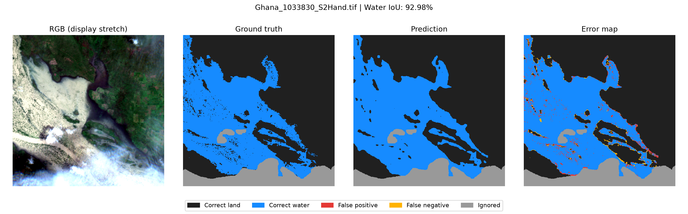
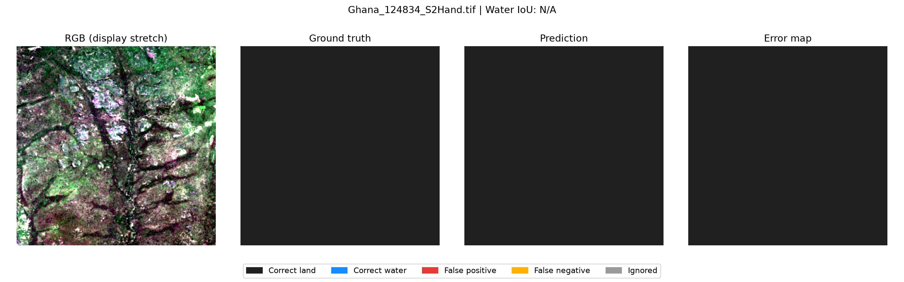
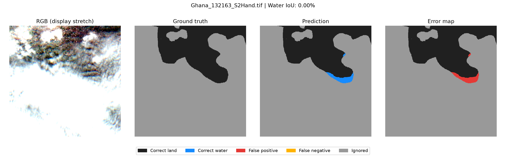

# Prithvi-EO-2.0 Flood Segmentation Reproduction

A single-seed reproduction of **Prithvi-EO-2.0-300M (non-TL)** on the **Sen1Floods11** flood segmentation benchmark.

This project documents environment setup, data inspection, fine-tuning, checkpoint verification, held-out evaluation, and prediction error analysis on an NVIDIA RTX 3090.

**Test results: 88.79% mIoU · 80.56% water IoU · 97.35% micro-F1**

## Reference

*Prithvi-EO-2.0: A Versatile Multitemporal Foundation Model for Earth Observation Applications*, IEEE Transactions on Geoscience and Remote Sensing, Vol. 64, 2026, article 4400120.

- [Paper](https://doi.org/10.1109/TGRS.2025.3642610)
- [Official model repository](https://github.com/NASA-IMPACT/Prithvi-EO-2.0)
- [TerraTorch](https://github.com/IBM/terratorch)
- [Sen1Floods11](https://github.com/cloudtostreet/Sen1Floods11)
- [Pretrained 300M model](https://huggingface.co/ibm-nasa-geospatial/Prithvi-EO-2.0-300M)

The model architecture, pretrained weights, dataset, and training framework originate from these upstream projects.

## Results

The paper results refer to the 300M non-TL model in Table IV. This reproduction reports one run with seed 0, while the paper reports means over ten runs.

| Test metric | Reproduction, seed 0 | Paper, ten-run mean | Difference |
|---|---:|---:|---:|
| mIoU | 88.79% | 89.7% | −0.91 pp |
| Water IoU | 80.56% | 82.2% | −1.64 pp |
| Micro-F1 | 97.35% | 97.6% | −0.25 pp |

Training completed **50 epochs and 800 optimizer updates** in approximately **80 minutes**. Peak PyTorch allocated memory was **12.21 GiB**.

The checkpoint from **epoch 48** was selected by minimum validation loss, reloaded for verification, and evaluated on the test split.

Its validation results were:

| Metric | Best-checkpoint validation |
|---|---:|
| Loss | 0.06466 |
| mIoU | 89.10% |
| Water IoU | 80.80% |
| Micro-F1 | 97.66% |

Recorded training and test logs are available under `results/`.

## Work Completed

- Inspected imagery and labels in QGIS, including dimensions, spectral bands, and class values.
- Prepared optical-image identifiers while retaining the official data split.
- Resolved backbone and dependency compatibility issues.
- Audited 294 pretrained encoder state entries, with no missing, unexpected, or mismatched entries.
- Conducted smoke tests and GPU memory checks.
- Completed full fine-tuning and verified checkpoint restoration.
- Evaluated the selected checkpoint on the held-out test split.
- Generated prediction panels and examined false positives, false negatives, and ignored regions.

## Experimental Setup

| Setting | Value |
|---|---|
| Backbone | Prithvi-EO-2.0-300M, non-TL |
| Fine-tuning | Full backbone and decoder |
| Input | One timestamp, resized to 448 × 448 |
| Bands | BLUE, GREEN, RED, NIR_NARROW, SWIR_1, SWIR_2 |
| Preprocessing | Scale by 0.0001, followed by DataModule normalization |
| Decoder | UPerNet, feature indices [5, 11, 17, 23] |
| Labels | 0 non-water, 1 water, −1 ignored |
| Loss | Cross-entropy, ignore_index=−1 |
| Augmentation | Horizontal and vertical flips, p=0.5 each |
| Optimizer | AdamW, learning rate 5e-5, weight decay 0.05 |
| Scheduler | CosineAnnealingLR, T_max=50 |
| Batch size | 8, with gradient accumulation over 2 batches |
| Precision | 16-mixed |
| Seed | 0 |
| Epoch limit | 50 |
| Validation | Every epoch |
| Early stopping | Validation loss, patience 20 |
| Checkpoint selection | Minimum validation loss |

The data split contains 252 training, 89 validation, and 90 test samples. The additional 15-sample Bolivia holdout was not evaluated.

## Environment

Hardware and platform: NVIDIA RTX 3090 24 GB, WSL Ubuntu 22.04, Python 3.11.

Core versions include PyTorch 2.5.0+cu124, TerraTorch 0.99.7, TorchGeo 0.6.2, Lightning 2.4.0, and timm 1.0.30.

`environment/versions.json` contains a snapshot taken during repository preparation. It records `lightning` and `pytorch-lightning` separately. The scripts import `lightning.pytorch`.

The original experiment record specifies TerraTorch commit:

```text
13875c1bbb546ffc15be8f1d9bc5828cb05b67fc
```

The current installation metadata did not retain a commit identifier, so this revision has not been independently reverified during publication. A clean-environment installation has not yet been validated.

## Repository Structure

```text
├── README.md
├── .gitignore
├── run_local.py
├── visualize_val.py
├── configs/
│   └── sen1floods11_300m.yaml
├── environment/
│   └── versions.json
├── results/
│   ├── training/
│   └── test/
└── figures/
```

## Data and Weights

Obtain the dataset and pretrained weights from the upstream resources. The public configuration expects the following layout:

```text
data/sen1floods11/
└── v1.1/
    ├── data/flood_events/HandLabeled/
    │   ├── S2Hand/
    │   └── LabelHand/
    └── splits/flood_handlabeled/
        ├── flood_train_data.txt
        ├── flood_valid_data.txt
        └── flood_test_data.txt

weights/
└── Prithvi_EO_V2_300M.pt
```

The TXT files must contain identifiers compatible with TerraTorch's dataset loader. In the original experiment, shared identifiers were extracted from the official CSV entries to match S2 optical imagery while preserving the official split.

Adjust configuration paths to match your local setup.

## Training

Run commands from the repository root after preparing the environment, data, and pretrained weights.

```bash
HF_HUB_OFFLINE=1 python run_local.py fit \
  --config configs/sen1floods11_300m.yaml
```

The entry point audits pretrained encoder loading and saves a run summary after completion.

## Validation and Testing

Replace the example checkpoint path with an existing fine-tuned checkpoint.

```bash
CHECKPOINT="/absolute/path/to/your/best.ckpt"

HF_HUB_OFFLINE=1 python run_local.py validate \
  --config configs/sen1floods11_300m.yaml \
  --ckpt_path "$CHECKPOINT" \
  --trainer.logger.init_args.name best_validate

HF_HUB_OFFLINE=1 python run_local.py test \
  --config configs/sen1floods11_300m.yaml \
  --ckpt_path "$CHECKPOINT" \
  --trainer.logger.init_args.name best_test
```

The recorded experiment selected `epochepoch=47-stepstep=768.ckpt`. Lightning uses zero-based epoch numbering.

## Prediction Visualization

```bash
CHECKPOINT="/absolute/path/to/your/best.ckpt"

python visualize_val.py \
  --config configs/sen1floods11_300m.yaml \
  --checkpoint "$CHECKPOINT"
```

The script visualizes the first three validation samples in dataset order. Each panel shows RGB imagery, ground truth, prediction, and an error map. RGB stretching is applied for display only.







In the error maps:

- Dark gray indicates correctly classified non-water.
- Blue indicates correctly classified water.
- Red indicates false positives.
- Yellow indicates false negatives.
- Gray indicates ignored labels.

When both the label and prediction contain no water, per-image water IoU is undefined and displayed as N/A. When water is predicted but no water is labeled, water IoU is zero.

All three examples come from the Ghana event and illustrate specific cases rather than geographic representativeness.

## Scope and Limitations

- Learning rate and weight decay were taken from the official sample configuration and have not been verified as the paper's final optimized values.
- The paper's ten-trial hyperparameter search was omitted.
- Only seed 0 was evaluated, so run-to-run variability has not been measured.
- Gradient accumulation over batches of 8 can behave differently from a direct batch of 16.
- Input resolution follows the journal flood protocol at 448 × 448.

The results support reproducibility of this model's performance on this task under the documented settings.

## Artifacts and Attribution

This repository includes scripts, configuration, metric logs, an environment snapshot, and derived visualization figures. Datasets, pretrained weights, and fine-tuned checkpoints are excluded from version control.

Upstream software, models, and data retain their respective licenses and attribution requirements.

The modified visualization entry point was tested using the original experiment configuration. The public relative-path configuration has not yet been fully validated with a newly arranged data directory.
